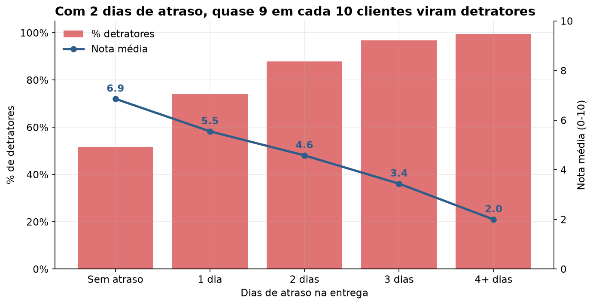
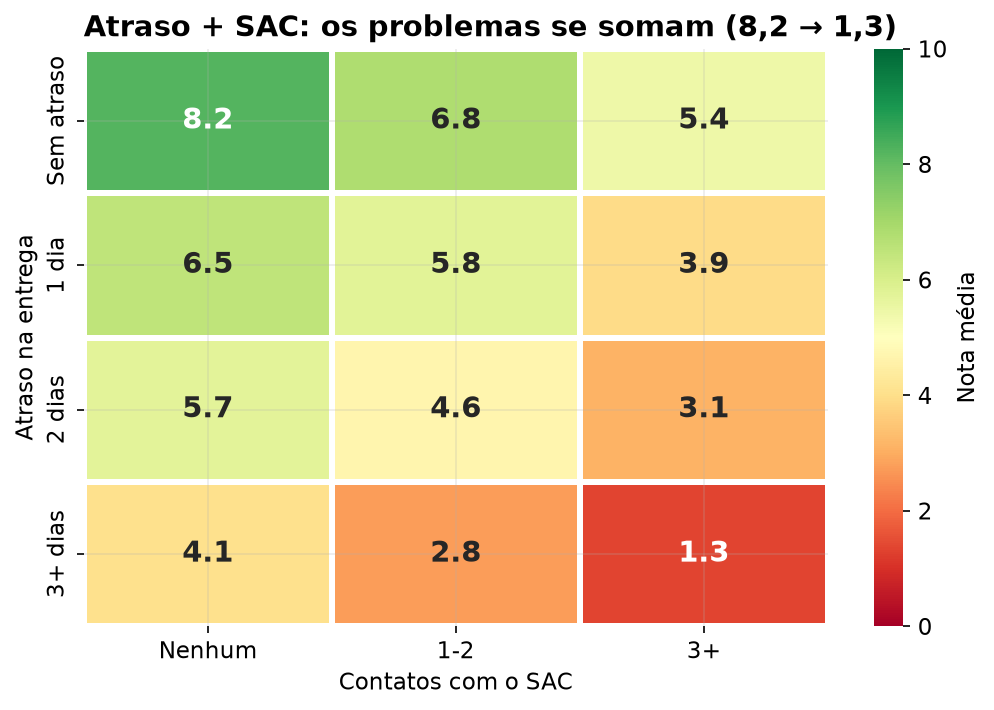

# NPS Preditivo — Tech Challenge Fase 1 (Pós Tech FIAP)

Análise de dados e modelo preditivo para entender **o que gera insatisfação** nos clientes de um e-commerce e **antecipar o NPS antes da pesquisa**.

> **Autor:** Vinícius Prado Batista — RM 378749
> **Vídeo executivo:** `<LINK DO VÍDEO>`
> **Apresentação:** [`reports/apresentacao/`](reports/apresentacao/)

---

## 1. Objetivo do projeto

A empresa coleta o NPS só **depois** que a jornada de compra termina, quando já não dá para agir. O objetivo deste projeto é:

1. **Entender** quais fatores operacionais (pedido, logística e atendimento) mais influenciam a satisfação;
2. **Comunicar** esses achados de forma clara para gestores não técnicos;
3. **Propor um modelo preditivo** que estime a nota e o risco de detração **antes** da pesquisa, para permitir ações proativas.

## 2. Principais resultados

| | |
|---|---|
| **NPS atual** | **-80** (84% detratores, 11% neutros, 4% promotores) |
| **Fator nº 1** | **Atraso na entrega**: 89% dos pedidos atrasam, e cada dia de atraso custa ~1 ponto na nota |
| **Fator nº 2** | **Reclamações e contatos com o SAC**: cada um tira entre 0,3 e 0,4 ponto |
| **Ponto de ruptura** | A partir de **2 dias de atraso** ou **2 reclamações**, praticamente não há promotores |
| **O que *não* importa** | Região, idade, tempo de casa, valor do pedido, desconto, parcelas e prazo total de entrega |
| **Por que importa** | **100% dos promotores** recompraram em 30 dias; **0% dos detratores** |
| **Modelo de regressão** | Regressão Linear: erro médio de **~1,4 ponto** (34% menor que o baseline), R² ≈ 0,51 no teste |
| **Modelo de classificação** | Regressão Logística: **ROC-AUC ≈ 0,87** no teste. Os 20% de maior risco têm nota média 1,6 |

<p align="center">
  
  
</p>

## 3. Base de dados

- **Arquivo:** [`data/raw/desafio_nps_fase_1.csv`](data/raw/desafio_nps_fase_1.csv) (fornecido pela FIAP)
- **Tamanho:** 2.500 pedidos, 2.500 clientes (1 pedido por cliente), 19 colunas, sem valores nulos

| Grupo | Colunas |
|---|---|
| Identificação | `customer_id`, `order_id` |
| Cliente | `customer_age`, `customer_region`, `customer_tenure_months` |
| Pedido | `order_value`, `items_quantity`, `discount_value`, `payment_installments` |
| Logística | `delivery_time_days`, `delivery_delay_days`, `freight_value`, `delivery_attempts` |
| Atendimento | `customer_service_contacts`, `resolution_time_days`, `complaints_count` |
| Satisfação / resultado | `nps_score` (alvo), `csat_internal_score`, `repeat_purchase_30d` |

A base tratada (com variáveis derivadas e flags de qualidade) é salva em `data/processed/nps_tratado.csv`.

## 4. Estrutura do repositório

```
├── data/
│   ├── raw/                     # base original (não é alterada)
│   └── processed/               # base tratada gerada pelo notebook 01
├── notebooks/
│   ├── 01_tratamento_dos_dados.ipynb   # qualidade, regras de negócio, outliers, features
│   ├── 02_analise_exploratoria.ipynb   # EDA com foco em negócio
│   └── 03_modelo_preditivo.ipynb       # regressão + classificação + simulações
├── src/
│   ├── config.py                # caminhos, colunas e regras de negócio (ex.: faixas do NPS)
│   ├── data_preparation.py      # carga, validação, tratamento e feature engineering
│   └── visualization.py         # padrão visual e gráficos reutilizáveis
├── models/                      # modelos treinados (.joblib)
├── reports/
│   ├── 01_entendimento_do_negocio.md   # etapas 1 e 2 (negócio e target)
│   ├── figures/                 # gráficos gerados pelos notebooks
│   └── apresentacao/            # slides do storytelling gerencial
├── requirements.txt
└── README.md
```

## 5. Metodologia

**Etapa 1 — Entendimento do negócio** ([`reports/01_entendimento_do_negocio.md`](reports/01_entendimento_do_negocio.md))
Problema de negócio, importância do NPS no e-commerce, áreas beneficiadas e impacto em recompra, boca a boca e market share.

**Etapa 2 — Definição da target** (mesmo documento)
`nps_score` (0-10) como alvo, com a categoria oficial do NPS (detrator < 7, neutro 7-8, promotor ≥ 9) e discussão dos riscos de uso (vazamento, viés de resposta etc.).

**Tratamento dos dados** ([`notebooks/01`](notebooks/01_tratamento_dos_dados.ipynb))
- Validação de colunas, tipos, nulos, duplicados e faixas de valores.
- Checagem de **regras de negócio** (ex.: atraso maior que o prazo, desconto maior que o pedido). As inconsistências foram **sinalizadas com flags**, não apagadas.
- Outliers **mantidos** (pedidos caros e atrasos longos são reais e relevantes).
- Criação de 14 variáveis derivadas (categoria do NPS, faixas de atraso, % de desconto etc.).
- Identificação das variáveis com **risco de vazamento** (`csat_internal_score` e `repeat_purchase_30d`).

**Análise exploratória** ([`notebooks/02`](notebooks/02_analise_exploratoria.ipynb))
Cada pergunta do enunciado é respondida com gráfico + explicação em linguagem de gestão: fatores críticos, causas de detração, ponto de ruptura, perfil de cliente e relação NPS x recompra.

**Modelo preditivo** ([`notebooks/03`](notebooks/03_modelo_preditivo.ipynb))
- Apenas variáveis disponíveis **antes** da pesquisa.
- Separação 80/20 estratificada + validação cruzada de 5 partes no treino.
- **Regressão** (nota 0-10): baseline x Regressão Linear x Random Forest x Gradient Boosting. Escolhida: Regressão Linear (melhor e mais explicável).
- **Classificação** (detrator sim/não): baseline x Regressão Logística x Random Forest x Gradient Boosting. Escolhida: Regressão Logística (maior ROC-AUC).
- Interpretação (coeficientes e importância por permutação), teste de vazamento, simulação de cenários e proposta de uso prático (fila de prioridade diária).

## 6. Como reproduzir

Pré-requisito: Python 3.10 ou superior.

```bash
# 1. Clonar o repositório
git clone <URL_DO_REPOSITORIO>
cd tech-challenge-nps-fase1

# 2. Criar e ativar um ambiente virtual
python -m venv .venv
source .venv/bin/activate        # Windows: .venv\Scripts\activate

# 3. Instalar as dependências
pip install -r requirements.txt

# 4. Executar os notebooks em ordem (01 -> 02 -> 03)
jupyter notebook notebooks/
```

Ou, para rodar tudo direto pelo terminal:

```bash
jupyter nbconvert --to notebook --execute --inplace notebooks/01_tratamento_dos_dados.ipynb notebooks/02_analise_exploratoria.ipynb notebooks/03_modelo_preditivo.ipynb
```

Os notebooks geram automaticamente a base tratada (`data/processed/`), os gráficos (`reports/figures/`) e os modelos (`models/`). Todos os processos aleatórios usam `random_state=42`, então os resultados são reproduzíveis.

## 7. Recomendações para o negócio

1. **Logística — atacar o atraso:** meta de atraso máximo de 1 dia, revisão de SLA com transportadoras e aviso proativo ao cliente quando houver risco de atraso.
2. **Atendimento — resolver no 1º contato:** tratar a 2ª reclamação como alerta vermelho e encaminhar para atendimento prioritário.
3. **CRM — agir antes da pesquisa:** fila diária de clientes com maior risco de detração, com ação de acordo com o motivo (atraso, reclamação ou SAC).
4. **Comercial — não "comprar" satisfação com desconto:** desconto e frete não mudam a nota. O investimento rende mais em logística e atendimento.
5. **Gestão — acompanhar a "nota prevista"** semanalmente por região e transportadora, sem esperar o resultado da pesquisa.

## 8. Limitações

- Base **sintética e pequena** (2.500 pedidos, 1 por cliente), sem data do pedido, transportadora, categoria de produto ou comentários abertos.
- O modelo explica cerca de **metade** da variação da nota. Fatores importantes ainda não estão nos dados.
- **Correlação não é causalidade:** as simulações servem para priorizar, e o ideal é validar com testes controlados.
- É preciso confirmar com o negócio que reclamações e tempo de resolução estão disponíveis **antes** do envio da pesquisa.
- Promotores são raros (4%), o que dificulta prever quem será promotor.
